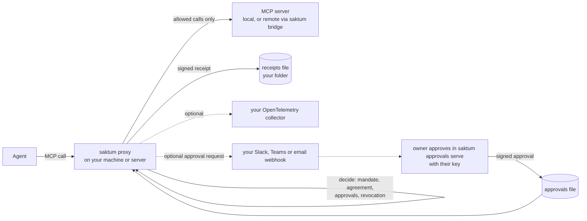

# Data flow

Nothing leaves your environment unless you send it (for example to your own OpenTelemetry collector or webhook).

| Data | Where it lives | Leaves your environment? |
| --- | --- | --- |
| Private keys | Owner-only files, environment variables, or the OS keychain | Never |
| Mandates, approvals, revocations, agreements | Local files you control | Only if you share them |
| Receipts | Local file (or shared folder you choose); argument digests, not values | Only to your collector, if configured |
| Tool arguments and results | Between the agent and the MCP server | Only to the MCP server you chose |
| Census and ledger | Public, published by Saktum | Contains no customer data |
